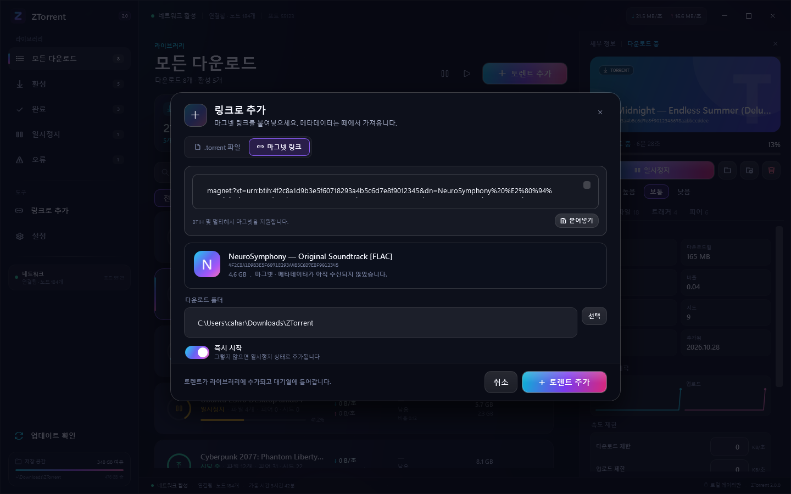
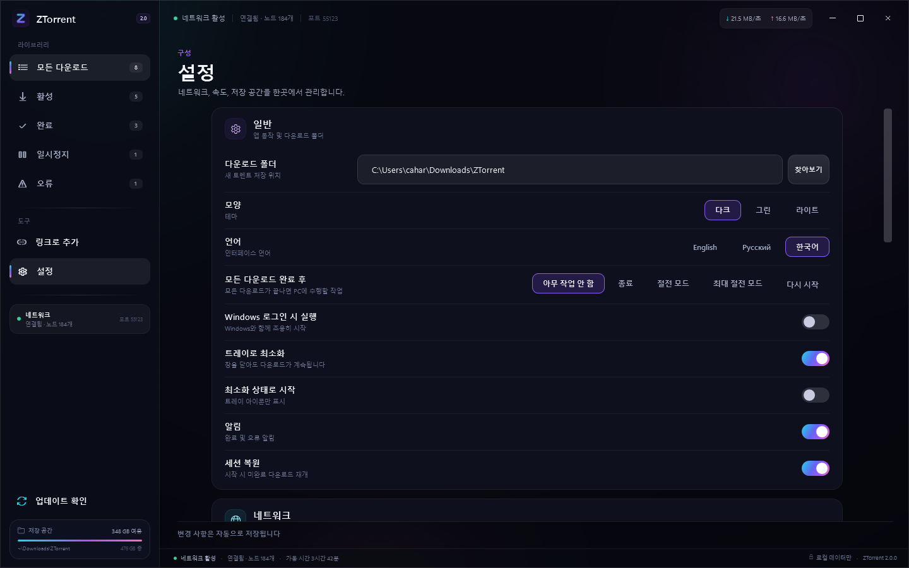
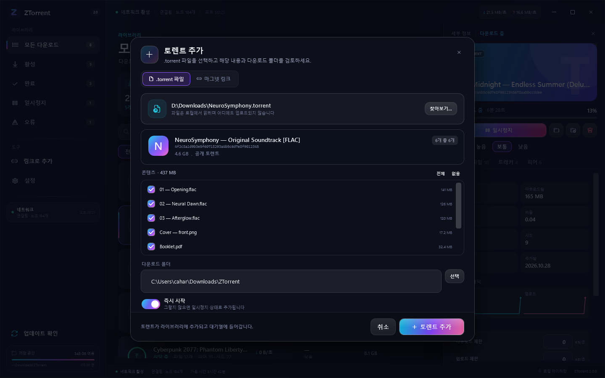

# ZTorrent — Windows 11용 오픈소스 토렌트 클라이언트 (C# / WPF)

[English](README.md) · [Русский](README.ru.md) · **한국어**

[](https://github.com/Cahard/ZTorrent/actions/workflows/ci.yml)
[](https://github.com/Cahard/ZTorrent/releases)
[](LICENSE)
[](https://dotnet.microsoft.com/)
[](https://www.microsoft.com/windows/windows-11)

<p align="center">
  <a href="https://github.com/Cahard/ZTorrent/releases/latest/download/ZTorrent-Setup.exe">
    
  </a>
  <a href="https://github.com/Cahard/ZTorrent/releases/latest/download/ZTorrent-Portable.zip">
    
  </a>
</p>

ZTorrent는 C# / .NET 10 / WPF와 **MonoTorrent 3.0.2**로 만든 Windows 11용 네이티브 **토렌트 클라이언트**입니다. Electron이나 내장 브라우저, 계정이 필요 없습니다. 마그넷 링크, DHT/PEX/LSD, MSE/PE 암호화, 어두운 그라데이션 인터페이스를 제공합니다.

모든 데이터는 로컬에서 처리됩니다. 라이브러리, 파일, 트래커, 피어, 설정이 하나의 창에 있고 텔레메트리나 클라우드 서비스가 없습니다. 앱 데이터는 `%LOCALAPPDATA%\ZTorrent`에 저장됩니다.


> [!NOTE]
> 스크린샷은 데모 모드에서 촬영했습니다. 모든 토렌트 이름, 피어, 숫자는 가상의 데이터입니다.

## 목차

- [기능](#기능)
- [ZTorrent를 선택하는 이유](#ztorrent를-선택하는-이유)
- [다운로드 및 설치](#다운로드-및-설치)
- [빠른 시작](#빠른-시작)
- [스크린샷](#스크린샷)
- [언어](#언어)
- [FastResume과 재시작](#fastresume과-재시작)
- [아키텍처](#아키텍처)
- [보안과 개인정보](#보안과-개인정보)
- [테스트](#테스트)
- [로드맵](#로드맵)
- [FAQ](#faq)
- [기여](#기여)
- [라이선스](#라이선스)

## 기능

### 추가 및 관리

- 파일 선택, 드래그 앤 드롭, `Ctrl+O`, 명령줄 인수로 `.torrent` 추가.
- 마그넷 링크 미리보기와 메타데이터 가져오기, BTIH 및 멀티해시 지원.
- 이름, 해시, 경로 검색, 상태 필터, 정렬, 실시간 카운터.
- 개별/전체 일시정지와 재개, 데이터 포함 또는 제외 삭제.
- 추가 전 파일 선택, 추가 후 파일별 우선순위(`DoNotDownload`, 낮음, 보통, 높음, 최대).
- 진행률과 완료율은 전체 토렌트가 아니라 선택한 파일 기준으로 계산.

### 다운로드와 네트워크

- **MonoTorrent 3.0.2** 엔진, DHT, PEX, LSD, UPnP/NAT-PMP, MSE/PE 암호화.
- 비공개 토렌트는 DHT/PEX에서 제외.
- 전역 다운로드/업로드 제한, 연결 수, 업로드 슬롯.
- 토렌트별 다운로드/업로드 속도 제한(0 = 개별 제한 없음).
- 세부 정보의 선택한 토렌트 다운로드/업로드 그래프.
- 설정은 자동 저장되며 라이브러리의 다른 보기로 이동하면 닫힙니다.
- N시간마다 GitHub Releases에서 업데이트를 자동 확인하고 선택적으로 자동 설치/재시작합니다.
- 사이드바의 수동 '업데이트 확인' 버튼.
- 세 가지 테마: 미드나이트, 그린, 라이트.
- High/Normal/Low 수동 다운로드 큐와 대기 상태 표시.
- 다운로드 중 폴더 이동: 파일을 옮기고 다운로드를 자동 재개.
- 세션 저장, **FastResume**, 일반 재시작 후 복구.
- 자동 시작, 트레이 모드, 완료/오류 알림, named pipe 기반 single-instance.

### Windows 11 인터페이스

- 다크 전용 Fluent 스타일 UI와 커스텀 `ProgressRing`, `LinearProgress`, `Sparkline`, `ShimmerBehavior`.
- 애니메이션 그라데이션 CTA와 aurora 배경, 호버/포커스 상태.
- 좁은 창에서 세부 정보 패널이 접히며 사용자의 수동 선택을 존중.
- 커스텀 크롬, Windows 11 둥근 모서리, 다크 타이틀바, 트레이, 네이티브 파일 대화상자.
- 단축키: `Ctrl+O`, `Ctrl+F`, `Space`, `Delete`, `Esc`.

### 자동화

- 모든 다운로드 완료 후 PC 작업: 종료, 절전, 최대 절전, 다시 시작.

### 데이터

- 설정, 세션, `.torrent` 사본, 메타데이터, 로그, 엔진 캐시는 로컬에 저장.
- 엔진 캐시: `%LOCALAPPDATA%\ZTorrent\cache`, FastResume: `%LOCALAPPDATA%\ZTorrent\cache\fastresume`.
- 원자적 JSON 저장, 손상된 상태 격리, 경로 안전 삭제.

## ZTorrent를 선택하는 이유

| 원칙 | 의미 |
|---|---|
| 네이티브 스택 | Electron이나 내장 브라우저 없이 WPF와 .NET 10 사용. |
| 오픈소스 | GPL-3.0: 직접 빌드하고 검토하고 포크할 수 있음. |
| 로컬 데이터 | 설정, 세션, 토렌트가 내 PC에 남음. |
| 명확한 범위 | 광고 플랫폼이 아닌 집중된 토렌트 클라이언트. |
| 안전 우선 | 토렌트 메타데이터의 모든 경로를 디스크 쓰기 전에 검증. |

## 다운로드 및 설치

위 버튼은 항상 최신 릴리스로 연결됩니다.

| 빌드 | 용도 | 요구 사항 |
|---|---|---|
| `ZTorrent-Setup.exe` | 시작 메뉴와 선택적 파일 연결이 포함된 일반 설치 | Windows 11 x64 |
| `ZTorrent-Portable.zip` | 폴더나 USB 드라이브에서 실행 | Windows 11 x64 |

설치 프로그램은 기본적으로 사용자 폴더(`%LOCALAPPDATA%\Programs\ZTorrent`)에 설치하며 관리자 권한이 필요 없습니다. 포터블 아카이브는 self-contained 빌드라 .NET을 설치할 필요가 없습니다.

> [!WARNING]
> 바이너리에 아직 코드 서명이 없어 Windows SmartScreen 경고가 표시될 수 있습니다. 이 저장소의 Releases 페이지만 사용하고 게시된 SHA-256 체크섬을 확인하세요.

## 빠른 시작

1. 설치 프로그램 또는 포터블 아카이브를 다운로드합니다.
2. `.torrent`를 추가하거나 창에 끌어다 놓고, 마그넷 링크를 붙여넣습니다.
3. 파일과 다운로드 폴더를 선택하고 즉시 시작 여부를 정합니다.
4. 세부 정보 패널에서 파일, 트래커, 피어, 파일별 우선순위를 관리합니다.
5. **설정**에서 언어, 속도 제한, DHT/PEX/LSD, 암호화, 트레이 동작, 다운로드 폴더를 변경합니다.

### 소스에서 빌드

Windows 10/11 x64와 .NET 10 SDK가 필요합니다.

```powershell
git clone https://github.com/Cahard/ZTorrent.git
cd ZTorrent
.\build.ps1
.\run.ps1
```

수동 빌드:

```powershell
dotnet restore ZTorrent.slnx
dotnet build ZTorrent.slnx -c Release
dotnet test tests\ZTorrent.Tests\ZTorrent.Tests.csproj -c Release
```

게시:

```powershell
.\publish.ps1                  # framework-dependent, .NET 10 Desktop Runtime 필요
.\publish.ps1 -SelfContained   # self-contained
```

### 파일 연결

설치 프로그램에서 `.torrent`와 `magnet:` 연결을 선택할 수 있습니다. 포터블 빌드는 다음을 실행하세요.

```powershell
pwsh -ExecutionPolicy Bypass -File .\scripts\register-file-associations.ps1 -ExePath .\ZTorrent.exe
```

## 스크린샷

| 라이브러리 | 마그넷으로 추가 |
|---|---|
|  |  |

| 설정 | 파일과 우선순위 |
|---|---|
|  |  |

| .torrent 추가 | 삭제 확인 |
|---|---|
|  |  |

## 언어

ZTorrent는 **영어(기본), 러시아어, 한국어**를 지원합니다. **설정 → 언어**에서 언제든 변경할 수 있고 즉시 적용되며 선택이 저장됩니다.

새 언어를 추가하려면 `src/ZTorrent.Core/Localization/*.json`을 편집하고 `AppLanguage`에 코드를 추가한 뒤 다시 빌드하세요. 영어 키가 누락된 번역의 fallback입니다.

## FastResume과 재시작

FastResume은 엔진 설정에서 활성화되어 있습니다.

- `AutoSaveLoadFastResume = true`
- `FastResumeMode.Accurate`
- 캐시 경로 `%LOCALAPPDATA%\ZTorrent\cache` → MonoTorrent가 `cache\fastresume\<infohash>.fresume`에 기록
- 정상 종료 시 `StopAllAsync`가 프로세스 종료 전에 FastResume을 저장

일반 재시작에서는 비트필드를 불러오므로 **수 GB를 다시 해시하지 않습니다**. `Accurate` 모드에서 강제 종료나 비정상 중지는 의도적으로 전체 해시 체크로 돌아갑니다. 오래된 조각을 무조건 신뢰하는 대신 정확성을 우선하기 때문입니다. 데이터와 함께 삭제할 때는 `RemoveMode.CacheDataOnly`를 사용해 삭제한 토렌트가 나중에 "100%"로 되살아나지 않게 합니다.

## 아키텍처

```text
ZTorrent.App (WPF, MVVM)
        │  스냅샷, 명령, 대화상자
        ▼
ZTorrent.Core (MonoTorrent 엔진, 저장, 경로 안전)
        │
        ▼
%LOCALAPPDATA%\ZTorrent
  settings.json  session.json  torrents\  cache\  logs\
```

- `ZTorrent.App` — 뷰, 뷰 모델, 커스텀 컨트롤, 트레이, single-instance IPC.
- `ZTorrent.Core` — 엔진 서비스, 세션/설정 저장소, 미리보기 검증, 경로 안전, 표시 형식.
- `ZTorrent.Tests` — 경로 안전, 설정/세션, 미리보기, 형식, 로컬 합성 토렌트 xUnit 테스트.
- `docs/` — 아키텍처, 디자인 시스템, UX 명세, 리서치, 테스트 계획.

UI는 엔진을 차단하지 않습니다. 스냅샷은 1초에 한 번, 세부 정보는 2초에 한 번 갱신되고 명령은 세마포어로 직렬화됩니다.

## 보안과 개인정보

- 텔레메트리, 분석, 광고, 클라우드 계정 없음.
- 토렌트 메타데이터의 모든 파일명은 `PathSafety`를 통과합니다. traversal, 절대 경로, UNC, ADS, 예약 이름, 제어 문자는 거부됩니다.
- 삭제는 다운로드 루트 안으로 제한되며 루트 자체는 삭제하지 않습니다.
- 설정/세션은 원자적으로 저장하고 손상된 JSON은 격리합니다.
- 비공개 토렌트는 DHT/PEX에 참여하지 않습니다.

보안 제보는 공개 issue 대신 [SECURITY.md](SECURITY.md)를 이용하세요.

## 테스트

**34개의 xUnit 테스트**가 다음을 검증합니다.

- path traversal, UNC/ADS, 예약 이름;
- 설정 검증과 원자적 저장;
- 세션 왕복과 손상된 상태 복구;
- `.torrent`/마그넷 미리보기 파싱;
- 표시 형식;
- 로컬 합성 토렌트의 추가, 일시정지, 재개, 삭제, 데이터 삭제, 세션 복구.

```powershell
dotnet test tests\ZTorrent.Tests\ZTorrent.Tests.csproj -c Release
```

## 로드맵

- 토렌트별 속도 제한, ratio/seed 규칙.
- 대역폭 스케줄 프로필.
- RSS와 토렌트 검색 확장 지점.
- MSIX 패키지와 코드 서명.
- 더 많은 번역과 접근성 개선.

## FAQ

### 광고가 있는 클라이언트인가요?

아니요. GPL-3.0 오픈소스이며 v2.0에는 광고, 텔레메트리, 유료 기능이 없습니다.

### Windows 10에서도 되나요?

지원 대상은 Windows 11 x64입니다. .NET 10 Desktop Runtime이 있으면 Windows 10에서도 실행될 수 있지만 테스트 매트릭스에는 포함되지 않습니다.

### 데이터는 어디에 저장되나요?

`%LOCALAPPDATA%\ZTorrent`의 `settings.json`, `session.json`, `torrents\`, `cache\`, `logs\`에 저장됩니다. 실제 파일은 선택한 다운로드 폴더에 있습니다.

### 파일과 우선순위를 선택할 수 있나요?

네. 추가 전에 파일을 선택하고, 세부 정보 패널에서 파일별 우선순위를 바꿀 수 있습니다.

### 마그넷 링크를 지원하나요?

네. BTIH와 멀티해시를 지원하며 메타데이터를 swarm에서 가져와 캐시합니다.

### 스케줄러나 토렌트별 제한이 있나요?

v2.0에는 전역 및 토렌트별 속도 제한, High/Normal/Low 큐가 있습니다. 시간 예약 스케줄러는 없습니다.

### 인터페이스가 영어만 지원하나요?

아니요. 기본은 영어이며 설정에서 러시아어와 한국어를 선택할 수 있습니다.

## 기여

이슈와 pull request를 환영합니다. [CONTRIBUTING.md](CONTRIBUTING.md)와 [CODE_OF_CONDUCT.md](CODE_OF_CONDUCT.md)를 읽어 주세요. 보안 문제는 공개 issue가 아니라 [SECURITY.md](SECURITY.md)를 통해 제보하세요.

## 라이선스

GPL-3.0. [LICENSE](LICENSE)를 참고하세요. MonoTorrent와 기타 의존성은 각자의 라이선스를 따르며 [THIRD-PARTY-NOTICES.md](THIRD-PARTY-NOTICES.md)에 정리되어 있습니다.
