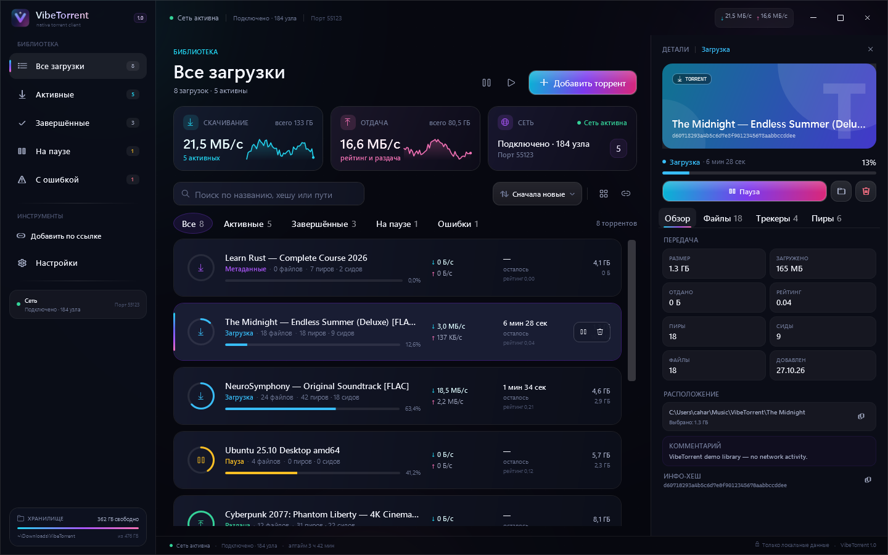
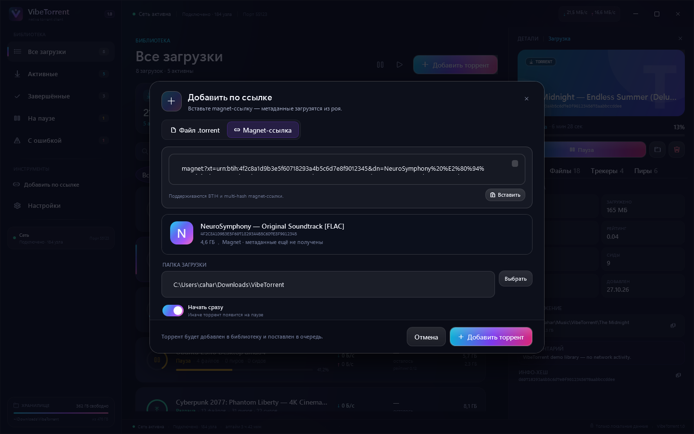
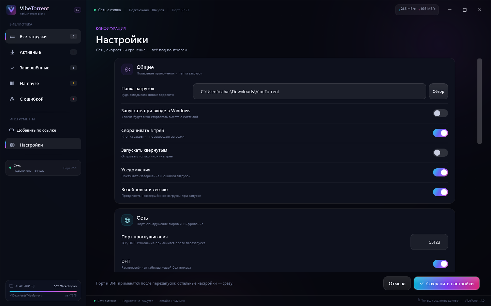
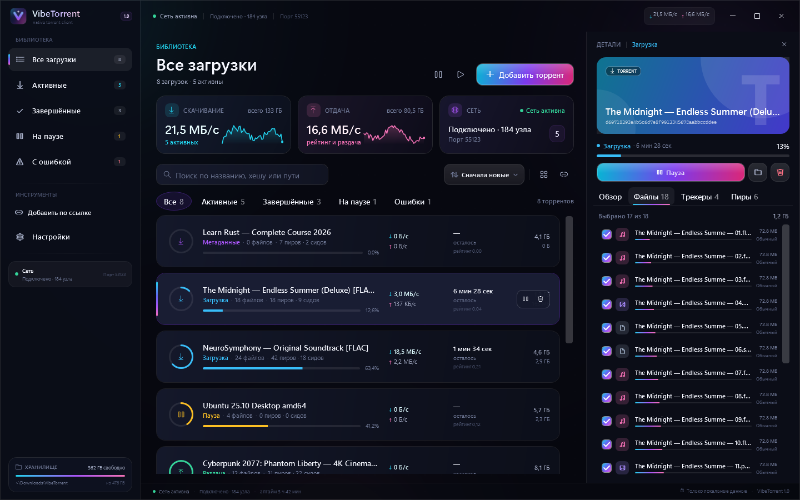
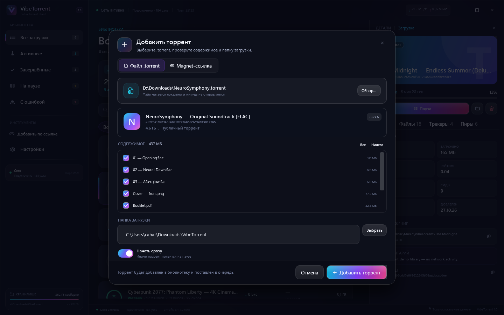
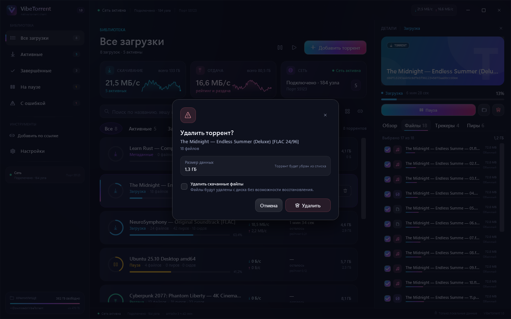
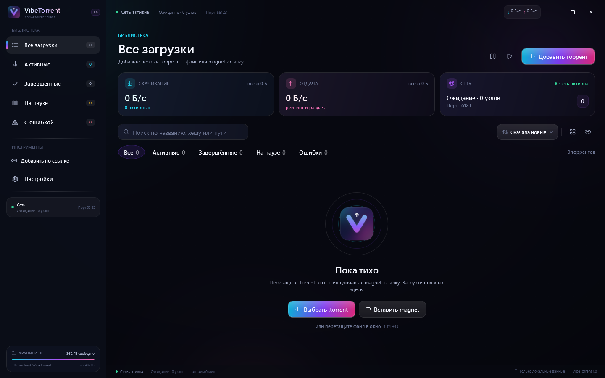

# VibeTorrent

Нативный торрент-клиент для Windows 11 на **C# / .NET 10 / WPF** с движком **MonoTorrent 3.0.2**.
Тёмный интерфейс с живыми градиентами, переливающимися кнопками и продуманной плотностью
данных: библиотека, детали, файлы, трекеры, пиры и настройки — без браузера и Electron.

> Скриншоты сделаны в демонстрационном режиме. Все торренты, имена и цифры в них вымышлены.



## Что умеет

- `.torrent` через файл, drag & drop, `Ctrl+O` и аргумент командной строки.
- Magnet-ссылки с предпросмотром и получением метаданных; BTIH и multi-hash.
- Пауза/возобновление одного торрента и всех сразу, удаление с данными и без.
- Выбор файлов до добавления и приоритеты файлов после (включая `DoNotDownload`).
- Панель деталей: обзор, файлы, трекеры и пиры с индивидуальными скоростями.
- Поиск, фильтры по состояниям, сортировка и счётчики.
- Глобальные лимиты скорости, соединений и слотов отдачи.
- DHT, PEX, LSD, UPnP/NAT-PMP, шифрование MSE/PE; приватные торренты не уходят в DHT/PEX.
- Сохранение сессии, fast resume, восстановление после перезапуска и аварийного завершения.
- Сворачивание в трей, уведомления о завершении и ошибках, single-instance через named pipe.
- Запуск при входе в Windows; опциональная регистрация `.torrent` и `magnet:`.
- Все данные — локально. Телеметрии и облачных сервисов нет.

### Экраны

| Библиотека | Добавление magnet |
|---|---|
|  |  |

| Настройки | Файлы торрента |
|---|---|
|  |  |

| Добавление `.torrent` | Удаление |
|---|---|
|  |  |

| Первый запуск |
|---|
|  |

## Стек и архитектура

```text
src/VibeTorrent.App     WPF UI, MVVM, тема, tray, chrome, single-instance
        │
        ▼
src/VibeTorrent.Core    MonoTorrent wrapper, DTO, сессия, настройки, безопасность путей
```

- **UI:** XAML + CommunityToolkit.Mvvm, кастомные `ProgressRing`, `LinearProgress`,
  `Sparkline`, `ShimmerBehavior`; анимации только на transform/opacity.
- **Движок:** `TorrentEngineService` — единственная точка работы с `ClientEngine`.
  Снимки состояния раз в секунду, детали по запросу, все мутации сериализованы.
- **Хранение:** `%LOCALAPPDATA%\VibeTorrent`
  - `settings.json` — настройки;
  - `session.json` — очередь, пути, paused-состояние, приоритеты файлов;
  - `torrents/` — копии `.torrent`;
  - `fastresume/`, `metadata/`, `cache/`, `logs/`.
- **Безопасность:** `.torrent` до 32 МБ, до 100 000 файлов; проверка path traversal,
  UNC, ADS и зарезервированных имён; удаление данных только внутри папки загрузки;
  лимиты не дают клиенту выйти за выбранный каталог.
- **Потоки:** диск/сеть не блокируют UI; события движка маршалятся через `IUiDispatcher`.
- **Сеть:** порт и DHT меняются при следующем запуске; остальные настройки применяются на лету.

Подробнее: [docs/ARCHITECTURE.md](docs/ARCHITECTURE.md).

## Запуск из исходников

Требуется Windows 10/11 x64 и [.NET 10 SDK](https://dotnet.microsoft.com/).
SDK можно положить в `.dotnet\dotnet.exe` — скрипты найдут его автоматически.

```powershell
# сборка + 24 теста
./build.ps1

# запуск
./run.ps1
```

Если PowerShell блокирует локальные скрипты:

```powershell
pwsh -ExecutionPolicy Bypass -File .\build.ps1
```

### Публикация

```powershell
# framework-dependent, рядом нужен .NET 10 Desktop Runtime
./publish.ps1

# самодостаточная сборка одним файлом
./publish.ps1 -SelfContained
```

Результат: `artifacts\publish\win-x64\VibeTorrent.exe`.

### Ассоциации файлов

```powershell
pwsh -ExecutionPolicy Bypass -File .\scripts\register-file-associations.ps1 `
    -ExePath .\artifacts\publish\win-x64\VibeTorrent.exe
```

Отмена: `scripts\unregister-file-associations.ps1`.

## Горячие клавиши

| Клавиши | Действие |
|---|---|
| `Ctrl+O` | Добавить `.torrent` |
| `Ctrl+V` | Вставить magnet из буфера обмена |
| `Ctrl+F` | Поиск по библиотеке |
| `Ctrl+,` | Настройки |
| `Space` | Пауза / продолжить выбранное |
| `Delete` | Удалить выбранный торрент |
| `Esc` | Закрыть диалог / сбросить поиск |

## Тесты

```powershell
dotnet test tests\VibeTorrent.Tests\VibeTorrent.Tests.csproj
```

Покрыто: path safety (traversal, UNC, ADS, reserved names), форматирование, атомарные
настройки/сессия, битый JSON, дедупликация, preview `.torrent`/magnet, приоритеты файлов,
add/pause/resume/remove, удаление данных и восстановление сессии после перезапуска.
Интеграционные тесты используют синтетический `.torrent` и работают без внешней сети.

Тест-план: [docs/testing/test-plan.md](docs/testing/test-plan.md).
Ревью движка: [docs/research/engine-review.md](docs/research/engine-review.md).

## Ограничения текущей версии

- Нет планировщика расписаний, per-torrent лимитов и seed-ratio правил.
- Смена порта и включение/выключение DHT применяются после перезапуска (UI предупреждает).
- Нет встроенного торрент-поиска и RSS.
- Уведомления — через трей Windows, без упакованного MSIX/Toast.
- Раздача и загрузка выполняются только на этом компьютере; удалённого управления нет.

## Лицензия

MIT. MonoTorrent распространяется под MIT; см. [LICENSE](LICENSE).
