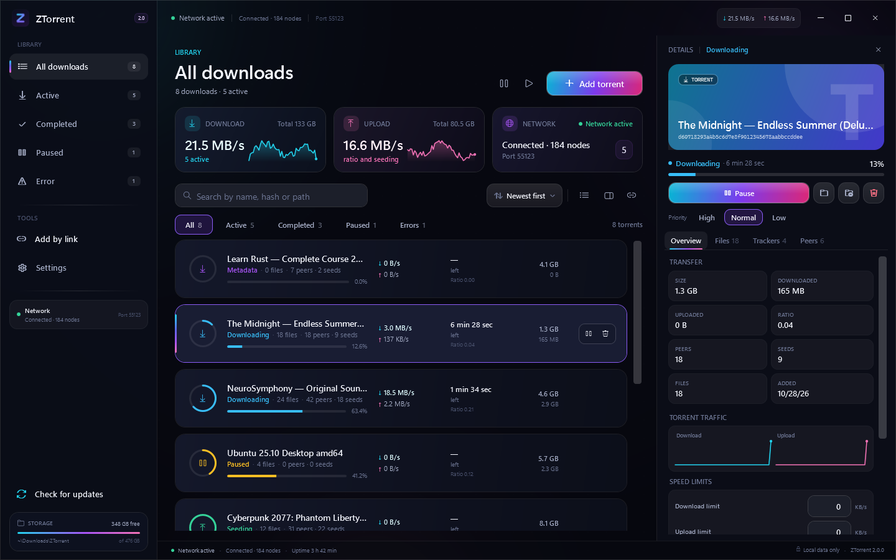
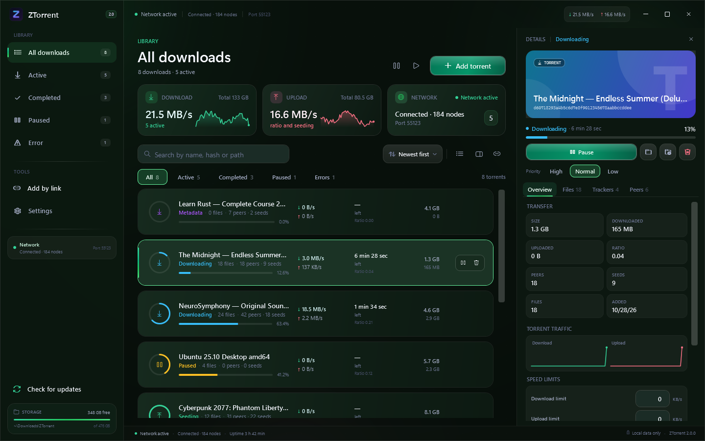
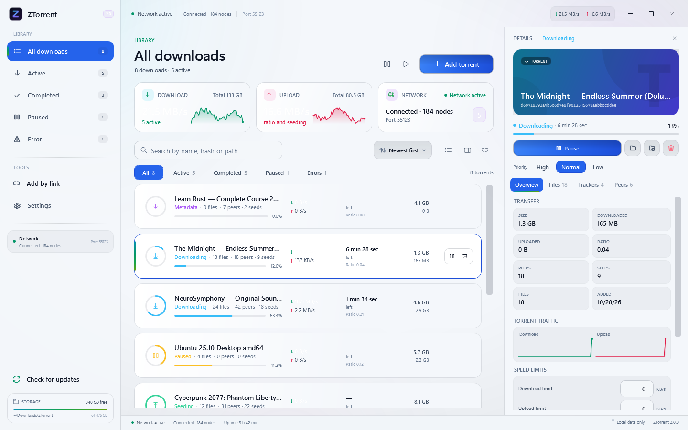
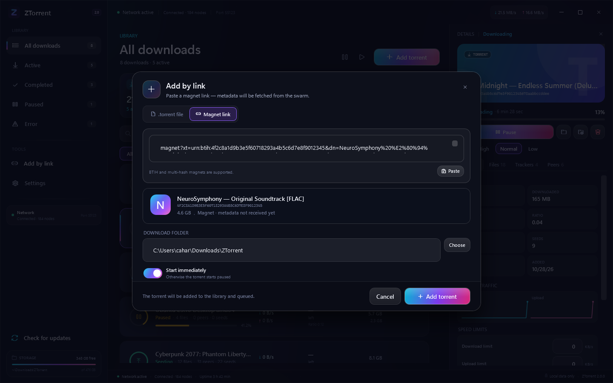
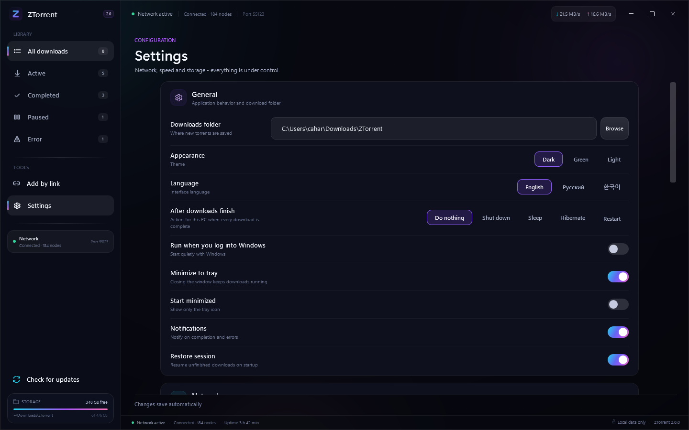
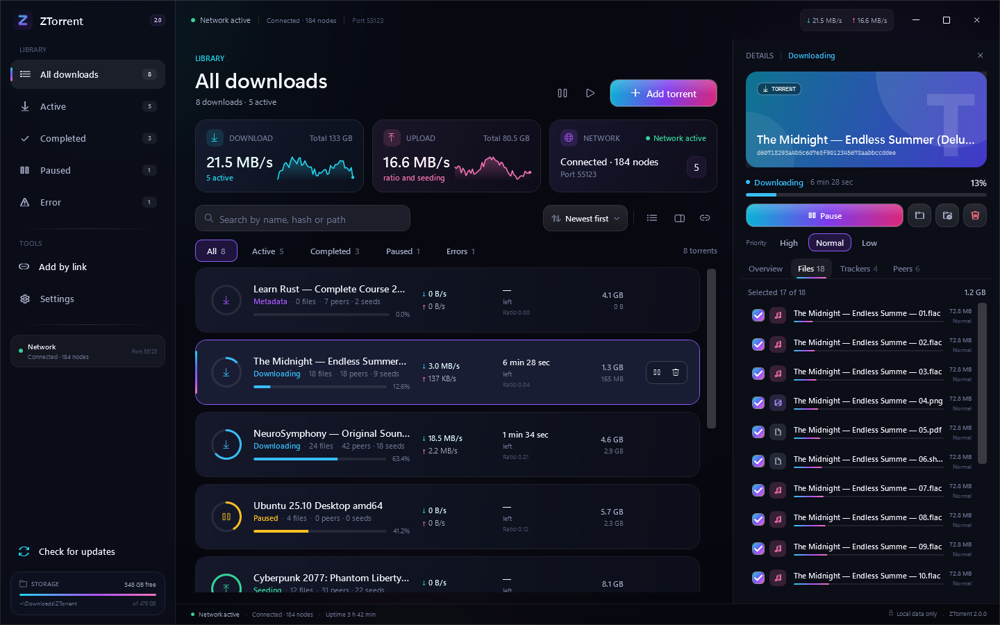
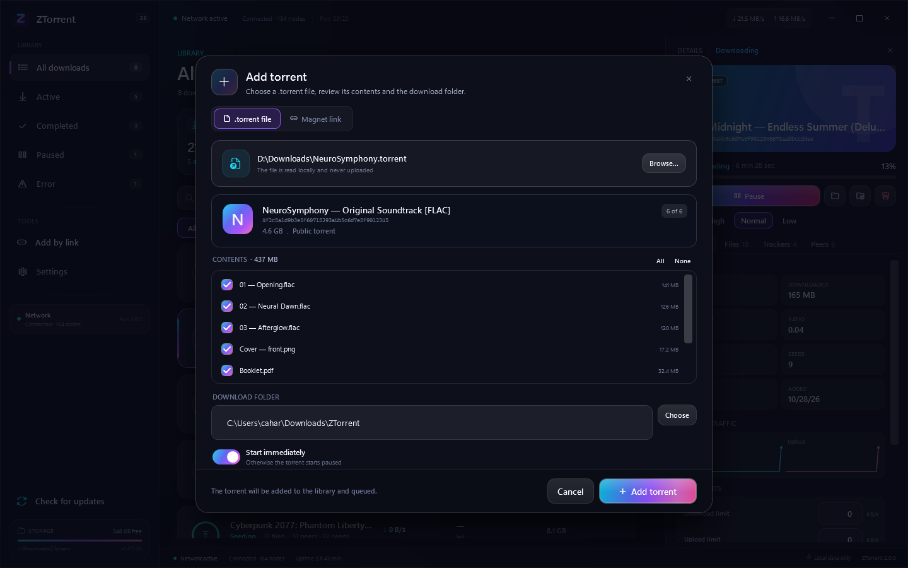

# ZTorrent — native open-source torrent client for Windows 11 (C# / WPF)

**English** · [Русский](README.ru.md) · [한국어](README.ko.md)

[](https://github.com/Cahard/ZTorrent/actions/workflows/ci.yml)
[](https://github.com/Cahard/ZTorrent/releases)
[](LICENSE)
[](https://dotnet.microsoft.com/)
[](https://www.microsoft.com/windows/windows-11)

<p align="center">
  <a href="https://github.com/Cahard/ZTorrent/releases/latest/download/ZTorrent-Setup.exe">
    
  </a>
  <a href="https://github.com/Cahard/ZTorrent/releases/latest/download/ZTorrent-Portable.zip">
    
  </a>
</p>

ZTorrent is a native **BitTorrent client for Windows 11** built with C# / .NET 10 / WPF and **MonoTorrent 3.0.2**. No Electron, no embedded browser, no account: a fast desktop client with magnet links, DHT/PEX/LSD, MSE/PE encryption and a dark, gradient-rich interface.

Everything is local: the library, files, trackers, peers and settings live in one window. No telemetry, no cloud services; application data is stored in `%LOCALAPPDATA%\ZTorrent`.


> [!NOTE]
> Screenshots are captured in demo mode. All torrent names, peers and numbers are fictional.

## Contents

- [Features](#features)
- [Why ZTorrent](#why-ztorrent)
- [Download and install](#download-and-install)
- [Quick start](#quick-start)
- [Screenshots](#screenshots)
- [Localization](#localization)
- [Fast resume and restart behaviour](#fast-resume-and-restart-behaviour)
- [Architecture](#architecture)
- [Security and privacy](#security-and-privacy)
- [Tests](#tests)
- [Roadmap](#roadmap)
- [FAQ](#faq)
- [Contributing](#contributing)
- [License](#license)

## Features

### Add and manage

- Add `.torrent` files via the file picker, drag & drop, `Ctrl+O` or a command-line argument.
- Paste magnet links with preview and metadata fetching; BTIH and multi-hash magnets.
- Search by name, hash or path; state filters; sorting; live counters.
- Pause, resume, pause all, resume all, remove with or without downloaded data.
- File selection before adding and per-file priorities after adding (`DoNotDownload`, low, normal, high, maximum).
- Progress and completion are calculated from selected files, not from the whole torrent.

### Download and network

- **MonoTorrent 3.0.2** engine with DHT, PEX, LSD, UPnP/NAT-PMP and MSE/PE encryption.
- Private torrents are excluded from DHT and PEX.
- Global download/upload limits, connection limit and upload slots.
- Per-torrent download/upload limits (0 = no per-torrent cap).
- Per-torrent download/upload traffic chart in the details pane.
- Settings save automatically; close them by switching to any library view.
- Automatic update checks from GitHub Releases every N hours, with optional install and restart.
- Visible update progress with downloaded size, percentage and a Cancel button; the app stays open while it downloads and only closes after the installer starts.
- Manual "Check for updates" action in the sidebar.
- Three themes: Midnight, Green and Light.
- Manual High/Normal/Low download queue with a visible Queued state.
- Move the download folder while a torrent is downloading; files are moved and the download resumes.
- Session persistence, fast resume and recovery after a normal restart.
- Optional autostart, tray mode, completion/error notifications and single-instance forwarding.

### Windows 11 interface

- Dark-only Fluent-inspired UI with custom `ProgressRing`, `LinearProgress`, `Sparkline` and `ShimmerBehavior`.
- Animated gradient primary actions and an aurora background; reduced-motion-friendly defaults.
- The details rail collapses at narrow widths and yields to the user's manual choice.
- Custom chrome, Windows 11 rounded corners, dark titlebar, tray integration and native file dialogs.
- Keyboard support: `Ctrl+O`, `Ctrl+F`, `Space`, `Delete`, `Esc`.

### Themes







### Automation

- Optional post-completion action for the PC: shut down, sleep, hibernate or restart when all downloads finish.

### Data

- Settings, session, `.torrent` copies, metadata, logs and engine cache are stored locally.
- Engine cache: `%LOCALAPPDATA%\ZTorrent\cache`; fast resume: `%LOCALAPPDATA%\ZTorrent\cache\fastresume`.
- Atomic JSON writes, corrupt-state quarantine and path-safe deletion.

## Why ZTorrent

| Principle | What it means |
|---|---|
| Native stack | WPF and .NET 10, not Electron or a bundled browser. |
| Open source | GPL-3.0: build it, inspect it, fork it. |
| Local data | Settings, session and torrents stay on your PC. |
| Honest scope | A focused torrent client, not an ad platform or a streaming service. |
| Safety first | Every path from torrent metadata is validated before it touches disk. |

## Download and install

The buttons above always point to the latest release:

| Build | Best for | Requirements |
|---|---|---|
| `ZTorrent-Setup.exe` | Normal installation with Start menu and optional file associations | Windows 11 x64 |
| `ZTorrent-Portable.zip` | Running from a folder or USB drive | Windows 11 x64 |

The installer is per-user by default (`%LOCALAPPDATA%\Programs\ZTorrent`) and does not require administrator rights. The portable archive contains the self-contained build; no .NET installation is needed.

> [!WARNING]
> The binaries are not code-signed yet, so Windows SmartScreen may show a warning. Download only from this repository's Releases page and verify the published SHA-256 checksums.

## Quick start

1. Download the installer or the portable archive.
2. Add a `.torrent` file, drop it onto the window, or paste a magnet link.
3. Pick the files and the download folder; choose whether to start immediately.
4. Use the details panel for files, trackers, peers and per-file priorities.
5. Open **Settings** to change the language, speed limits, DHT/PEX/LSD, encryption, tray behaviour and the download folder.

### Build from source

Requirements: Windows 10/11 x64, .NET 10 SDK.

```powershell
git clone https://github.com/Cahard/ZTorrent.git
cd ZTorrent
.\build.ps1
.\run.ps1
```

Manual build:

```powershell
dotnet restore ZTorrent.slnx
dotnet build ZTorrent.slnx -c Release
dotnet test tests\ZTorrent.Tests\ZTorrent.Tests.csproj -c Release
```

Publish:

```powershell
.\publish.ps1                  # framework-dependent; needs .NET 10 Desktop Runtime
.\publish.ps1 -SelfContained   # self-contained
```

### File associations

The installer can optionally register `.torrent` and `magnet:` links. For a portable build, run:

```powershell
pwsh -ExecutionPolicy Bypass -File .\scripts\register-file-associations.ps1 -ExePath .\ZTorrent.exe
```

## Screenshots

| Library | Add by magnet |
|---|---|
|  |  |

| Settings | Files and priorities |
|---|---|
|  |  |

| Add a .torrent file | Remove confirmation |
|---|---|
|  |  |

## Localization

ZTorrent ships with **English (default), Russian and Korean**. Change the language at any time in **Settings → Language**; the interface updates immediately and the choice is persisted.

To add a language, edit `src/ZTorrent.Core/Localization/*.json`, add the code to `AppLanguage`, and rebuild. English keys are also the fallback for missing translations.

## Fast resume and restart behaviour

Fast resume is enabled in the engine settings:

- `AutoSaveLoadFastResume = true`
- `FastResumeMode.Accurate`
- cache directory `%LOCALAPPDATA%\ZTorrent\cache`, so MonoTorrent writes `cache\fastresume\<infohash>.fresume`
- `StopAllAsync` on normal exit flushes the fast-resume state before the process ends

On a normal restart the bitfield is loaded and the client does **not** re-hash gigabytes of data. With `Accurate` mode, a hard crash or a non-clean stop intentionally falls back to a full hash check: the client prefers correctness over silently trusting stale pieces. Removing a torrent with data uses `RemoveMode.CacheDataOnly`, so a deleted download cannot later reappear as a "100%" torrent.

## Architecture

```text
ZTorrent.App (WPF, MVVM)
        │  snapshots, commands, dialogs
        ▼
ZTorrent.Core (MonoTorrent engine, persistence, path safety)
        │
        ▼
%LOCALAPPDATA%\ZTorrent
  settings.json  session.json  torrents\  cache\  logs\
```

- `ZTorrent.App` — views, view models, custom controls, tray, single-instance IPC.
- `ZTorrent.Core` — engine service, session/settings stores, preview validation, path safety, display formatting.
- `ZTorrent.Tests` — xUnit tests for path safety, settings/session, preview parsing, formatting and a local synthetic torrent.
- `docs/` — architecture, design system, UX spec, research and test plan.

The UI never blocks the engine: snapshots are sampled once per second, details twice per second, and all commands are serialized through a semaphore.

## Security and privacy

- No telemetry, analytics, ads or cloud accounts.
- Every torrent file name passes through `PathSafety` before writing: traversal, absolute paths, UNC, ADS, reserved names and control characters are rejected.
- Deletion is restricted to the download root and never removes the root itself.
- Session/settings writes are atomic; corrupt JSON is quarantined instead of crashing the app.
- Private torrents never join DHT/PEX.

See [SECURITY.md](SECURITY.md) for responsible disclosure.

## Tests

**34 xUnit tests** cover:

- path traversal, UNC/ADS and reserved-name validation;
- settings validation and atomic persistence;
- session round-trips and corrupted-state recovery;
- torrent/magnet preview parsing;
- display formatting;
- a local synthetic torrent: add, pause, resume, remove, delete data and restore session.

```powershell
dotnet test tests\ZTorrent.Tests\ZTorrent.Tests.csproj -c Release
```

## Roadmap

- Per-torrent speed limits and ratio/seed rules.
- Scheduled bandwidth profiles.
- RSS and a torrent search extension point.
- MSIX package and code signing.
- More translations and accessibility polish.

## FAQ

### Is ZTorrent an ad-supported client?

No. It is open source under GPL-3.0, with no ads, telemetry or paid tier in v2.0.

### Does it work on Windows 10?

The supported target is Windows 11 x64. Windows 10 may work with the .NET 10 Desktop Runtime, but it is not part of the test matrix.

### Where is my data stored?

`%LOCALAPPDATA%\ZTorrent`: `settings.json`, `session.json`, `torrents\`, `cache\`, `logs\`. Download payloads live in the folder you choose.

### Can I choose files and priorities?

Yes. Select files before adding, then change priorities per file in the details panel.

### Are magnet links supported?

Yes, including BTIH and multi-hash links. Metadata is fetched from the swarm and cached.

### Is there a scheduler or per-torrent limit?

v2.0 supports global and per-torrent speed limits plus the High/Normal/Low queue. A time-based scheduler is not included.

### Is the interface only in English?

No. English is the default; Russian and Korean are included in Settings.

## Contributing

Issues and pull requests are welcome. Read [CONTRIBUTING.md](CONTRIBUTING.md) and [CODE_OF_CONDUCT.md](CODE_OF_CONDUCT.md). For security reports, use [SECURITY.md](SECURITY.md), not a public issue.

## License

GPL-3.0. See [LICENSE](LICENSE). MonoTorrent and other dependencies are distributed under their own licenses; see [THIRD-PARTY-NOTICES.md](THIRD-PARTY-NOTICES.md).
