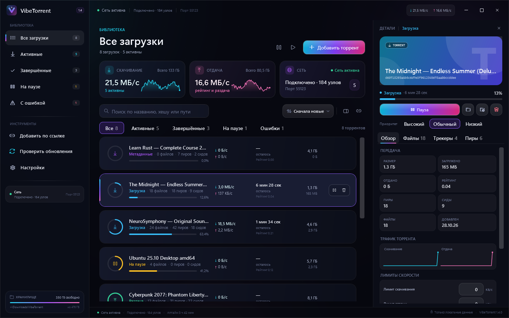
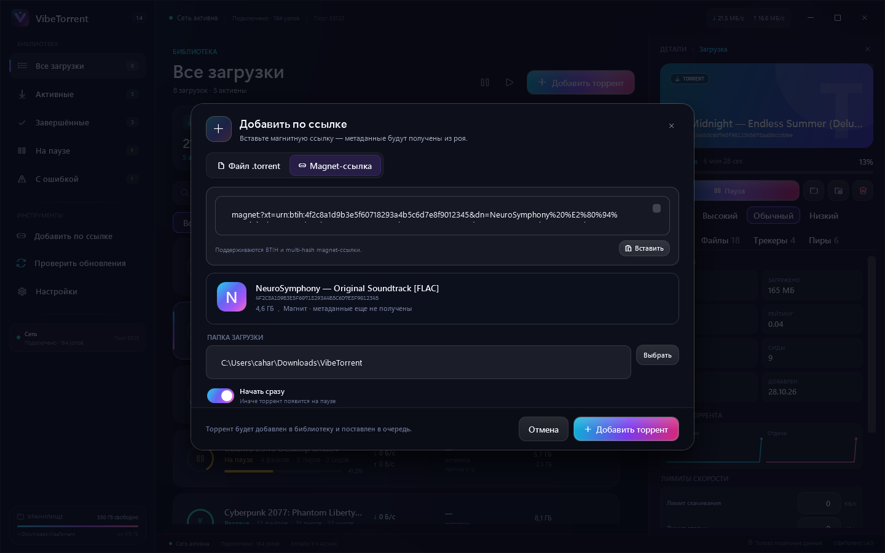
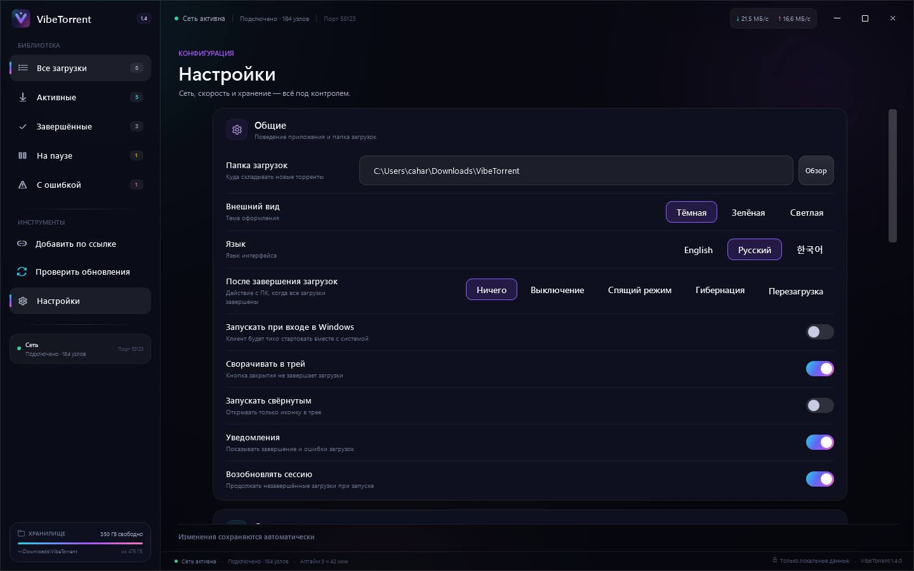
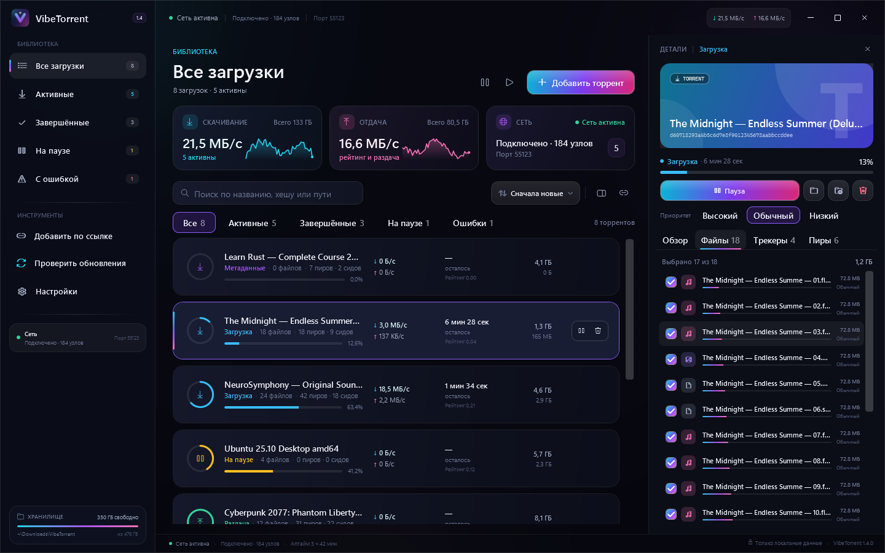
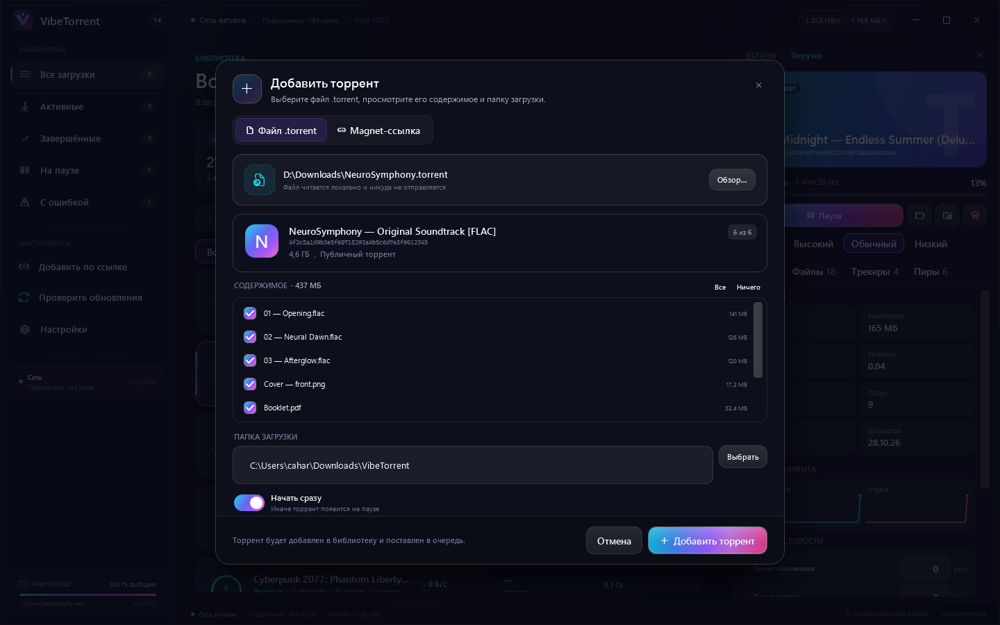
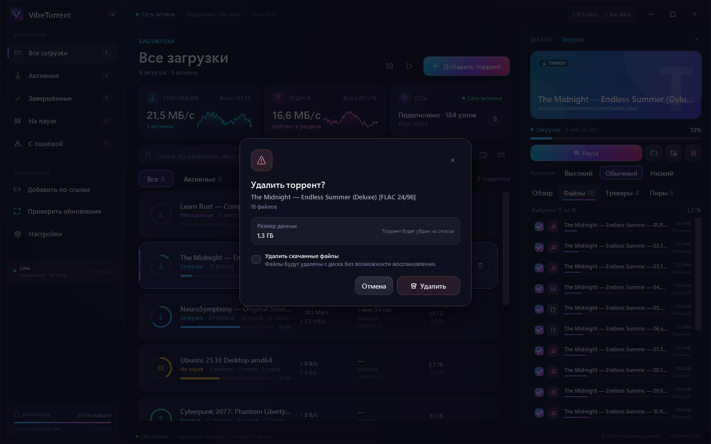

# VibeTorrent — нативный open-source торрент-клиент для Windows 11 на C# / WPF

[English](README.md) · **Русский** · [한국어](README.ko.md)

[](https://github.com/Cahard/VibeTorrent/actions/workflows/ci.yml)
[](https://github.com/Cahard/VibeTorrent/releases)
[](LICENSE)
[](https://dotnet.microsoft.com/)
[](https://www.microsoft.com/windows/windows-11)

<p align="center">
  <a href="https://github.com/Cahard/VibeTorrent/releases/latest/download/VibeTorrent-Setup.exe">
    
  </a>
  <a href="https://github.com/Cahard/VibeTorrent/releases/latest/download/VibeTorrent-Portable.zip">
    
  </a>
</p>

VibeTorrent — нативный **торрент-клиент для Windows 11** на C# / .NET 10 / WPF с движком **MonoTorrent 3.0.2**. Без Electron, встроенного браузера и аккаунтов: magnet-ссылки, DHT/PEX/LSD, шифрование MSE/PE и тёмный интерфейс с живыми градиентами.

Всё работает локально: библиотека, файлы, трекеры, пиры и настройки — в одном окне. Ни телеметрии, ни облачных сервисов: данные приложения лежат в `%LOCALAPPDATA%\VibeTorrent`.



> [!NOTE]
> Скриншоты сделаны в демонстрационном режиме. Все торренты, имена и цифры в них вымышлены.

## Содержание

- [Возможности](#возможности)
- [Почему VibeTorrent](#почему-vibetorrent)
- [Скачать и установить](#скачать-и-установить)
- [Быстрый старт](#быстрый-старт)
- [Скриншоты](#скриншоты)
- [Локализация](#локализация)
- [FastResume и перезапуск](#fastresume-и-перезапуск)
- [Архитектура](#архитектура)
- [Безопасность и приватность](#безопасность-и-приватность)
- [Тесты](#тесты)
- [Roadmap](#roadmap)
- [FAQ](#faq)
- [Участие в разработке](#участие-в-разработке)
- [Лицензия](#лицензия)

## Возможности

### Добавление и управление

- `.torrent` через файл, drag & drop, `Ctrl+O` или аргумент командной строки.
- Magnet-ссылки с предпросмотром и получением метаданных; BTIH и multi-hash.
- Поиск по названию, хешу или пути, фильтры по состояниям, сортировка и счётчики.
- Пауза и возобновление одного торрента или всех сразу; удаление с данными и без.
- Выбор файлов до добавления и приоритеты после: `DoNotDownload`, низкий, обычный, высокий, максимальный.
- Прогресс и завершённость считаются по выбранным файлам, а не по всему торренту.

### Загрузка и сеть

- Движок **MonoTorrent 3.0.2** с DHT, PEX, LSD, UPnP/NAT-PMP и шифрованием MSE/PE.
- Приватные торренты не уходят в DHT и PEX.
- Глобальные лимиты скорости, соединений и слотов отдачи.
- Лимиты скачивания/отдачи для каждого торрента (0 — без отдельного лимита).
- График скачивания/отдачи выбранного торрента в панели деталей.
- Настройки сохраняются автоматически; закрываются переходом в любой раздел библиотеки.
- Автопроверка обновлений из GitHub Releases раз в N часов с опциональной тихой установкой и перезапуском.
- Ручная кнопка «Проверить обновления» в боковом меню.
- Три темы: «Полночь», «Зелёная» и «Светлая».
- Ручная очередь High/Normal/Low с состоянием «В очереди».
- Перенос папки загрузки активного торрента с сохранением файлов и возобновлением загрузки.
- Сохранение сессии, **FastResume** и восстановление после обычного перезапуска.
- Автозапуск, работа в трее, уведомления о завершении и ошибках, single-instance через named pipe.

### Интерфейс Windows 11

- Три темы (тёмная, зелёная, светлая), кастомные `ProgressRing`, `LinearProgress`, `Sparkline` и `ShimmerBehavior`.
- Анимированные градиентные CTA и aurora-фон; аккуратные состояния наведения и фокуса.
- Панель деталей сворачивается при узком окне и не спорит с ручным выбором пользователя.
- Кастомный chrome, скруглённые углы Windows 11, тёмный titlebar, трей и нативные диалоги.
- Горячие клавиши: `Ctrl+O`, `Ctrl+F`, `Space`, `Delete`, `Esc`.

### Автоматизация

- Действие после завершения всех загрузок: выключение, спящий режим, гибернация или перезагрузка ПК.

### Данные

- Настройки, сессия, копии `.torrent`, метаданные, логи и кэш движка хранятся локально.
- Кэш движка: `%LOCALAPPDATA%\VibeTorrent\cache`; FastResume: `%LOCALAPPDATA%\VibeTorrent\cache\fastresume`.
- Атомарная запись JSON, карантин повреждённого состояния и безопасное удаление файлов.

## Почему VibeTorrent

| Принцип | Что это значит |
|---|---|
| Нативный стек | WPF и .NET 10, без Electron и встроенного браузера. |
| Открытый код | GPL-3.0: проект можно собрать, проверить и форкнуть. |
| Локальные данные | Настройки, сессия и торренты остаются на компьютере. |
| Честный scope | Сфокусированный торрент-клиент, а не рекламная платформа. |
| Безопасность | Каждый путь из метаданных проверяется до записи на диск. |

## Скачать и установить

Кнопки выше всегда ведут на последний релиз:

| Сборка | Для чего | Требования |
|---|---|---|
| `VibeTorrent-Setup.exe` | Обычная установка, меню «Пуск», опциональные ассоциации файлов | Windows 11 x64 |
| `VibeTorrent-Portable.zip` | Запуск из папки или с USB-накопителя | Windows 11 x64 |

Установщик ставит приложение в профиль пользователя (`%LOCALAPPDATA%\Programs\VibeTorrent`) и не требует прав администратора. Портативный архив содержит self-contained сборку — .NET устанавливать не нужно.

> [!WARNING]
> Бинарники пока не подписаны сертификатом, поэтому Windows SmartScreen может показать предупреждение. Скачивайте файлы только со страницы Releases этого репозитория и сверяйте SHA-256.

## Быстрый старт

1. Скачайте установщик или портативный архив.
2. Добавьте `.torrent`, перетащите его в окно или вставьте magnet-ссылку.
3. Выберите файлы и папку загрузки; решите, начинать ли сразу.
4. Откройте панель деталей: файлы, трекеры, пиры и приоритеты.
5. В **Настройках** смените язык, лимиты, DHT/PEX/LSD, шифрование, поведение трея и папку загрузок.

### Сборка из исходников

Нужны Windows 10/11 x64 и .NET 10 SDK.

```powershell
git clone https://github.com/Cahard/VibeTorrent.git
cd VibeTorrent
.\build.ps1
.\run.ps1
```

Вручную:

```powershell
dotnet restore VibeTorrent.slnx
dotnet build VibeTorrent.slnx -c Release
dotnet test tests\VibeTorrent.Tests\VibeTorrent.Tests.csproj -c Release
```

Публикация:

```powershell
.\publish.ps1                  # framework-dependent, нужен .NET 10 Desktop Runtime
.\publish.ps1 -SelfContained   # self-contained
```

### Ассоциации файлов

Установщик может зарегистрировать `.torrent` и `magnet:`. Для портативной версии:

```powershell
pwsh -ExecutionPolicy Bypass -File .\scripts\register-file-associations.ps1 -ExePath .\VibeTorrent.exe
```

## Скриншоты

| Библиотека | Добавление по magnet |
|---|---|
|  |  |

| Настройки | Файлы и приоритеты |
|---|---|
|  |  |

| Добавление .torrent | Подтверждение удаления |
|---|---|
|  |  |

## Локализация

VibeTorrent поставляется с **английским (по умолчанию), русским и корейским** языками. Язык меняется в **Настройки → Язык**, интерфейс обновляется сразу, выбор сохраняется.

Чтобы добавить язык, отредактируйте `src/VibeTorrent.Core/Localization/*.json`, добавьте код в `AppLanguage` и пересоберите проект. Английские ключи служат fallback для отсутствующих переводов.

## FastResume и перезапуск

FastResume включён в настройках движка:

- `AutoSaveLoadFastResume = true`
- `FastResumeMode.Accurate`
- кэш `%LOCALAPPDATA%\VibeTorrent\cache`, поэтому MonoTorrent пишет `cache\fastresume\<infohash>.fresume`
- при обычном выходе вызывается `StopAllAsync`, который сохраняет FastResume до завершения процесса

При обычном перезапуске битфилд загружается, и клиент **не перехэширует гигабайты данных**. В режиме `Accurate` жёсткий краш или нештатная остановка намеренно приводят к полному хеш-чеку: клиент предпочитает корректность доверию устаревшим кускам. Удаление торрента с данными использует `RemoveMode.CacheDataOnly`, поэтому удалённая загрузка не может позже «ожить» как 100%.

## Архитектура

```text
VibeTorrent.App (WPF, MVVM)
        │  снимки, команды, диалоги
        ▼
VibeTorrent.Core (движок MonoTorrent, хранение, path safety)
        │
        ▼
%LOCALAPPDATA%\VibeTorrent
  settings.json  session.json  torrents\  cache\  logs\
```

- `VibeTorrent.App` — представления, view models, кастомные контролы, трей, single-instance IPC.
- `VibeTorrent.Core` — сервис движка, хранилища сессии/настроек, preview, path safety, форматирование.
- `VibeTorrent.Tests` — xUnit-тесты path safety, настроек/сессии, preview, форматирования и локального синтетического торрента.
- `docs/` — архитектура, дизайн-система, UX-спецификация, исследования и тест-план.

UI не блокирует движок: снимки обновляются раз в секунду, детали — дважды в секунду, команды сериализуются через семафор.

## Безопасность и приватность

- Ни телеметрии, ни аналитики, ни рекламы, ни облачных аккаунтов.
- Каждое имя из торрент-метаданных проходит `PathSafety`: traversal, абсолютные пути, UNC, ADS, зарезервированные имена и управляющие символы отклоняются.
- Удаление ограничено папкой загрузки; сама корневая папка не удаляется.
- Запись настроек и сессии атомарная; повреждённый JSON отправляется в карантин.
- Приватные торренты не участвуют в DHT/PEX.

Отчёты об уязвимостях — по [SECURITY.md](SECURITY.md), не в публичный issue.

## Тесты

**33 xUnit-теста** покрывают:

- path traversal, UNC/ADS и зарезервированные имена;
- валидацию настроек и атомарное сохранение;
- сессию и восстановление после повреждённого состояния;
- разбор `.torrent`/magnet;
- форматирование значений;
- локальный синтетический торрент: добавление, паузу, возобновление, удаление, удаление данных и восстановление сессии.

```powershell
dotnet test tests\VibeTorrent.Tests\VibeTorrent.Tests.csproj -c Release
```

## Roadmap

- Лимиты на отдельный торрент, ratio и seed-правила.
- Расписание профилей скорости.
- RSS и точка расширения для поиска торрентов.
- MSIX-пакет и подпись кода.
- Больше переводов и accessibility-полировка.

## FAQ

### VibeTorrent — бесплатный клиент с рекламой?

Нет. Код открыт под GPL-3.0, в v1.4 нет рекламы, телеметрии и платных функций.

### Работает ли на Windows 10?

Поддерживаемая цель — Windows 11 x64. На Windows 10 с .NET 10 Desktop Runtime может работать, но это не входит в тестовую матрицу.

### Где хранятся данные?

`%LOCALAPPDATA%\VibeTorrent`: `settings.json`, `session.json`, `torrents\`, `cache\`, `logs\`. Сами файлы — в выбранной папке загрузки.

### Можно ли выбрать файлы и приоритеты?

Да. Выберите файлы до добавления, затем меняйте приоритет каждого файла на вкладке деталей.

### Поддерживаются ли magnet-ссылки?

Да, включая BTIH и multi-hash. Метаданные загружаются из роя и кэшируются.

### Есть ли планировщик и лимиты на торрент?

В v1.4 есть глобальные и персональные лимиты скорости, а также очередь High/Normal/Low. Планировщика по расписанию нет.

### Интерфейс только на английском?

Нет. Английский — по умолчанию; русский и корейский доступны в настройках.

## Участие в разработке

Issues и pull requests приветствуются. Прочитайте [CONTRIBUTING.md](CONTRIBUTING.md) и [CODE_OF_CONDUCT.md](CODE_OF_CONDUCT.md). Об уязвимостях — через [SECURITY.md](SECURITY.md), не в публичный issue.

## Лицензия

GPL-3.0. См. [LICENSE](LICENSE). MonoTorrent и остальные зависимости распространяются по своим лицензиям; см. [THIRD-PARTY-NOTICES.md](THIRD-PARTY-NOTICES.md).
